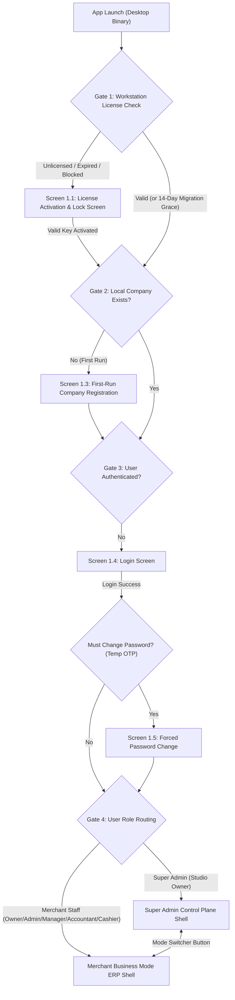
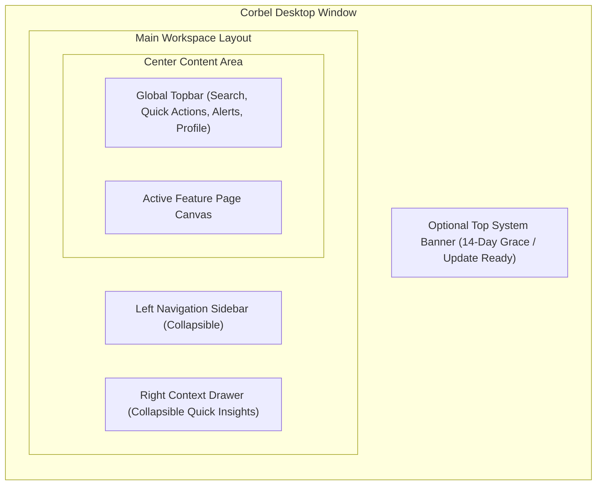

# Corbel ERP (v1.3.2+) — Complete UI/UX Designer Handoff & Interface Specification

**Product**: Corbel ERP — Sovereign Desktop Enterprise Resource Planning & SaaS Control Plane  
**Studio**: The Foolish Crow Studio (Taha Asadullah)  
**Target Platform**: Cross-Platform Desktop Application (Windows, Linux, macOS via Tauri + Webview)  
**Architecture**: Local-First SQLite Engine + Neon Cloud PostgreSQL Control Plane  
**Repository Copy**: [`ijazandcompany/docs/DESIGNER_HANDOFF_SPECIFICATION.md`](file:///run/media/thefoolishcrow/New%20Volume/Obsidian/TheFallenCrow/ijazandcompany/docs/DESIGNER_HANDOFF_SPECIFICATION.md)

---

## 1. Executive Summary & Design Philosophy

Corbel ERP is a **hybrid local-first desktop ERP** built for Small and Medium Businesses (SMBs), retail shops, wholesale distributors, and FBR-compliant merchants in Pakistan, paired with a cloud-connected **Super Admin Control Plane** used by The Foolish Crow Studio to govern client licenses, hardware seats, and SaaS subscriptions.

### 1.1 Why This System Exists (And What the Redesign Must Solve)
1. **Zero-Latency Local Operations (Merchant Business Mode)**: Cashiers and store owners cannot wait on slow internet connections during checkout. Every sale, stock movement, and ledger entry executes locally in milliseconds. The UI must feel like a precision desktop instrument—fast, keyboard-navigable, and uncluttered.
2. **Sovereign Cloud Governance (Super Admin Control Plane)**: The studio owner needs a high-signal command center to onboard tenants, issue 14-day trial or commercial license keys (`CRBL-XXXX-XXXX-XXXX`), lock licenses to physical hardware (`HWID`), extend trials (`+14 Days`), toggle paid modules (`FBR`, `Multi-Currency`, `Audit Trail`, `Custom Roles`), and remotely block compromised devices.
3. **Ergonomics Across Literacy & Skill Levels**:
   - **Cashiers** need large, high-contrast hit targets, instant barcode/product search, and zero accounting jargon.
   - **Accountants & Owners** need dense, scannable financial tables, clear debit/credit alignment, and one-click CSV/PDF/Excel exports.

### 1.2 Global Visual & Ergonomic Guidelines for the Designer
* **No Generic AI/Template Bloat**: Avoid decorative gradients, floating glass cards with no hierarchy, or redundant icons (never place two icons inside one button, or mix emoji characters with vector icons).
* **Typography & Numeric Alignment**: All currency amounts (`PKR`, `USD`, etc.), quantities, tax rates, invoice numbers, and hardware IDs **must** use tabular monospace numerals (`font-variant-numeric: tabular-nums`) and right-align in tables so decimals line up vertically.
* **Keyboard-First Speed**: Primary workflows (POS invoicing, global search `Ctrl+K`, modal confirmation) must visibly indicate keyboard shortcuts.
* **Explicit State Design**: Every screen in this specification requires five designed states:
  1. **Populated State** (realistic Pakistani merchant data: PKR currency, NTN/STRN tax numbers, batch numbers).
  2. **Empty State** (helpful illustration/icon, plain-language explanation, and a single primary Call-to-Action button).
  3. **Loading State** (clean structural skeletons, never jarring full-page spinners).
  4. **Validation / Error State** (inline field-level error messages + non-intrusive toast notifications).
  5. **Offline / Grace Warning State** (subtle status indicators when cloud sync or FBR queue is working offline).

---

## 2. System Entry Flow & Master State Machine

Before a user ever sees a dashboard, the desktop application evaluates **four sequential gates** on startup. The designer must provide screens for each gate.

---

## 3. Part I — Pre-Workspace Gates (Licensing, Setup & Auth Screens)

### Screen 1.1: Workstation License Activation & Kill-Switch Lock Screen
When a new prospect installs Corbel ERP, or when a trial expires or a device is blocked by the Super Admin, this full-window screen blocks access to the application.

* **Visual Variants Required (3 States of the Same Screen)**:
  1. **Standard Unlicensed State (New Installation / Expired 14-Day Migration Grace)**:
     - Neutral/brand header: *"Activate Corbel ERP Workstation"*.
     - Prompt to enter the 14-character license key (`CRBL-XXXX-XXXX-XXXX`).
  2. **Offline Grace Expired State (`is_offline_grace = true`, `is_blocked = false`)**:
     - Amber warning state: *"Offline Lease Expired — Connect to the internet and click Re-Verify to refresh your workstation lease."*
  3. **Remote Kill-Switch / Expired Trial Blocked State (`is_blocked = true`)**:
     - High-alert crimson danger state: *"Access Restricted by Administrator"* (or *"License Validity Period Has Expired"*).
     - Displays the exact `block_reason` returned from the server (e.g., `"Invoice overdue"`, `"Hardware signature mismatch"`, `"14-Day trial expired"`).
* **Data Fields & Controls**:
  - **Read-Only Hardware Identity Card**:
    - `Device Hardware ID (HWID)`: e.g. `CRBL-HWID-8F9A-3C12-90B1-44E2` with a **Copy HWID** button (so the merchant can send it to support).
    - `Workstation Name` (e.g. `COUNTER-PC-01`) & `Operating System` (`Windows 11 / Linux`).
  - **Activation Form**:
    - `License Key` input (`CRBL-XXXX-XXXX-XXXX`, auto-uppercase, monospace).
    - `Workstation Label` optional input (allows merchant to name the counter PC).
    - Primary CTA: **Activate Workstation** (`activate_license`).
    - Secondary CTA: **Re-Check Connection / Retry Verification** (`check_license_status`).

### Component 1.2: 14-Day Trial / Grace Top Banner, Day-15 Read-Only Mode & Inline Activation Modal
When a new company registers via `SetupPage`, or an existing merchant runs under the automatic **14-day evaluation trial** (`license_type = 'trial'` or `is_migration_grace = true`), they are **not** locked out:
* **Active 14-Day Trial Top Banner (Days 1–14)**:
  - High-visibility amber bar across the top of the window.
  - Copy: *"14-Day Free Trial: Evaluate Corbel ERP with full access."*
  - Badge: **`[X] days remaining`** (counts down from 14 to 1).
  - Actions: **Contact Taha Asadullah** (`mailto:tahaasad709@gmail.com`) and **Enter License Key** (opens the Inline Activation Modal).
* **Day-15+ Expired Trial / Subscription Read-Only Banner (`daysRemaining <= 0`)**:
  - Persistent crimson banner across the top of the workspace: *"Read-Only Mode (14-Day Trial Expired): Your 14-day evaluation period has ended. You can still view and export all existing invoices, inventory, ledger, and reports, or open Support Tickets, but creating or editing records is locked until you upgrade."*
  - Backend enforcement (`require_active_subscription`): All `view` and `export` actions and `tickets` commands remain open; mutating commands (`create`, `edit`, `delete`, `import`) are blocked until upgraded.
* **Direct Contact Card (`SupportContactCard`)**:
  - Reusable card displayed on `SetupPage`, `LoginPage`, `ActivationScreen`, `LicenseLockedScreen`, `ModuleLockedView`, and `SupportTicketsTab` with direct contact details for **Taha Asadullah (The Foolish Crow Studio — `tahaasad709@gmail.com`)**.

### Screen 1.3: First-Run Company Setup Screen (`SetupPage`)
Shown automatically on first launch when `is_company_setup()` is `false` (no company in local SQLite yet).
* **Form Fields**:
  - `Company Name` (required)
  - `Company Email`, `Phone Number`, `Business Address`
  - `Tax / NTN Number` (optional at setup)
  - `Owner Full Name` (required)
  - `Owner Email` (required — becomes the primary login email)
  - `Owner Password` (required, minimum 8 characters)
* **Primary CTA**: **Create Company & Start 14-Day Free Trial** (provisions a 14-day `trial` subscription on `pkg-basic` (`3,400 PKR`), seeds default modules, and syncs to Neon Cloud).
* **Secondary Navigation**: **"Already have an account? Sign in"** button to switch to `LoginPage`, plus `SupportContactCard` footer.

### Screen 1.4: Login Screen & Screen 1.5: Forced Password Reset (Temp OTP)
* **Screen 1.4 (Login)**:
  - `Email Address` input.
  - `Password` input with show/hide toggle.
  - `Remember Session on This Workstation` checkbox.
  - Primary CTA: **Sign In**.
  - Secondary CTA: **"New to Corbel ERP? Start your 14-Day Free Trial"** button to switch to `SetupPage`, plus `SupportContactCard` footer.
  - Rate-limit lockout notice area (displays remaining lockout seconds if 5 failed attempts occur).
* **Screen 1.5 (Forced Password Change — `must_change_password = true`)**:
  - Triggered immediately after login when the Super Admin has reset a tenant user's password via a Temporary OTP.
  - Fields: `Current (Temporary) Password`, `New Password`, `Confirm New Password`.
  - Actions: **Update Password & Enter Workspace** or **Sign Out**.

---

## 4. Part II — Merchant Business Mode: Global App Shell

Once authenticated into Business Mode, the interface uses a persistent desktop shell composed of four regions:

### 4.1 Left Navigation Sidebar
Grouped into **4 logical sections** (items automatically hide if the user's role lacks permission or if the tenant's SaaS package disables the module):
1. **Overview**:
   - **Dashboard** (`dashboard`)
2. **Sales & Customers**:
   - **Invoices & POS** (`invoices`)
   - **Customers** (`customers`)
3. **Inventory & Supply Chain**:
   - **Inventory Hub** (`inventory` — Products, Batches, Categories, Suppliers, Units, Import Wizard)
   - **Purchase Orders** (`purchase_orders`)
4. **Finance & Administration**:
   - **Accounting Ledger** (`ledger`)
   - **Financial Reports** (`reports`)
   - **Settings** (`settings`)
* **Super Admin Escape Hatch**: If the logged-in user has `is_super_admin = true`, display a prominent **"Switch to Super Admin Control Plane"** button at the top or bottom of the sidebar.

### 4.2 Global Topbar
* **Breadcrumb / Active Page Title** (left).
* **Global Command Search (`Ctrl + K`)**: Instant omnibox searching across Products (by name/SKU), Customers (by name/phone), Invoices (by invoice number), and Purchase Orders.
* **Quick Backup Button**: One-click button allowing the Owner to save a `.db` snapshot via native OS file dialog (or routing to Settings → Backup).
* **Notification Bell & Popover**:
  - Displays unread count badge.
  - Popover lists real-time system alerts categorized by severity (`critical`, `warning`, `info`):
    - *Low Stock Alerts* (clicking jumps to Inventory filtered by low stock).
    - *Expiring / Expired Batch Alerts* (clicking jumps to Batch Expiry view).
    - *Overdue Unpaid Invoices* (clicking opens the Invoice).
    - *FBR Fiscalization Queue Failures* (clicking jumps to Settings → FBR).
* **User Identity Chip**: Shows `Full Name`, `Role Badge` (`Owner`, `Admin`, `Manager`, `Accountant`, `Cashier`), link to **My Profile**, and **Sign Out**.

### 4.3 Collapsible Right Context Drawer
A toggleable utility panel on the right edge providing at-a-glance operational pulse without leaving the current screen:
* Active User & Company Summary card + **Manage Profile** action.
* Live **Alert Counters** (`Low Stock Items` count, `Unpaid Invoices` count).
* Context-aware shortcuts for the active page.

---

## 5. Part III — Merchant Business Mode: Screen-by-Screen Specifications

### Screen 3.1: Executive Dashboard (`dashboard`)
The morning command center for the merchant.
* **Component A: Interactive Onboarding Checklist Card** (dismissible once 100% complete):
  - Tracks 5 setup milestones with progress bar (`0%` to `100%`) and **Launch Guided Tour** button:
    1. *Configure Company Profile & NTN* → deep-links to `Settings → Company`.
    2. *Add Units & Categories* → deep-links to `Inventory`.
    3. *Add Your First Product / Import Catalog* → deep-links to `Inventory`.
    4. *Create Your First Sale (POS)* → deep-links to `Invoices & POS`.
    5. *Create a Safety Backup* → deep-links to `Settings → Backup`.
* **Component B: KPI Summary Row (4 Metric Cards)**:
  - `Total Revenue` (with period comparison badge).
  - `Net Profit & Margin %`.
  - `Outstanding Receivables` (unpaid invoice total + count).
  - `Inventory Health` (total active SKUs + low-stock warning count).
* **Component C: Visual Charts**:
  - **Monthly Revenue vs. Cost / Profit Trend** (Bar/Area chart).
  - **Top 5 Selling Products** & **Top 5 Customers by Revenue**.
* **Component D: Quick Action Bar**:
  - **New Sale (POS)**, **Add Product**, **New Customer**, **Record Expense / Journal Entry**.

---

### Screen 3.2: Sales, Invoicing & High-Speed POS (`invoices`)
This is the highest-frequency screen in the entire ERP. It must support both **fast retail counter checkout** and **B2B wholesale invoicing**.

#### View 3.2A: Invoices Directory (List View)
* **Filters & Search**: Search by Invoice # or Customer Name; filter by Status (`All`, `Draft`, `Finalized/Unpaid`, `Partially Paid`, `Paid`, `Cancelled`), Date Range, and FBR Submission Status.
* **Table Columns**:
  - `Invoice #` (e.g. `INV-00042`)
  - `Customer Name` (or `Walk-In Customer`)
  - `Issue Date` & `Due Date`
  - `Status Badge` (`Draft`, `Issued`, `Partial`, `Paid`, `Cancelled`)
  - `FBR Status Badge` (`Fiscalized` with FBR Invoice #, `Queued`, `Failed`, `N/A`)
  - `Total Amount`, `Amount Paid`, `Balance Due`
  - `Row Actions`: View/Print, Record Payment, Cancel/Credit Note.

#### View 3.2B: POS / Invoice Creation & Editing Workspace
Designed for 100% keyboard operation (`Tab`, `Enter`, barcode scanner input) as well as mouse/touch:
* **Header Section (Customer & Metadata)**:
  - `Customer Selector` (searchable dropdown with inline **New Customer** quick-create modal; defaults to Walk-In).
  - `Invoice Date`, `Due Date`, `Currency Selector` (defaults to `PKR`; if Multi-Currency module enabled, allows `USD`/`AED`/`GBP`/`EUR`/`SAR` with live/manual `Exchange Rate` field).
  - `Tax Rate (%)` and `Order-Level Discount`.
* **Fast Line-Item Entry Bar**:
  - `Product Search / Barcode Input` (shows live available stock quantity, SKU, and selling price in dropdown).
  - `Quantity` input (warns immediately if quantity exceeds available stock).
  - `Unit Price` input (pre-filled from product, editable if permitted).
  - `Item Discount` (`%` or fixed amount).
  - **Add Line (`Enter`)** button.
* **Line Items Table**:
  - Columns: `#`, `Product / SKU`, `Unit`, `Qty`, `Unit Price`, `Discount`, `Tax`, `Line Total`, `Remove`.
* **Totals & Checkout Summary Footer**:
  - `Subtotal`, `Total Discount`, `Tax Amount`, **`Grand Total` (large, high-contrast typography)**.
  - Primary Actions:
    - **Save as Draft** (`draft` — does not deduct stock yet).
    - **Finalize & Issue Invoice** (`finalize_invoice` — deducts stock via FIFO batches, posts double-entry accounting journal, and queues FBR fiscalization if enabled).
    - **Finalize & Print Thermal Receipt** (one-step POS checkout).

#### View 3.2C: Invoice Detail, Payment Recording & Print Preview
* **Action Toolbar**:
  - **Back to Invoices**, **Record Payment** (opens modal with `Amount`, `Payment Method`: Cash / Bank Transfer / Cheque / Card, `Reference #`, `Notes`), **Print / Thermal 80mm / A4 PDF Preview**, **Export Excel** (using custom merchant Excel template if configured), **Issue Credit Note (Return)** / **Debit Note**, **Cancel Invoice**.
* **Print Preview Canvas**:
  - Toggle between **80mm Thermal POS Receipt** layout and **A4 Commercial Tax Invoice** layout (including official **FBR Digital Invoicing QR Code** and FBR Invoice Number when fiscalized).

---

### Screen 3.3: Inventory & Supply Chain Hub (`inventory`)
Organized into clean sub-navigation tabs so merchants can manage their catalog without clutter:

#### Tab 1: Products Catalog
* **Toolbar**: Search by Name/SKU/Barcode, Filter by `Category`, `Supplier`, `Stock Status` (`All`, `Low Stock`, `Out of Stock`), **Import Products (Wizard)**, **Expiring Batches View**, **New Product**.
* **Products Table Columns**:
  - `SKU / Code`, `Product Name`, `Category`, `Unit` (e.g. `pcs`, `kg`, `box`), `Cost Price`, `Selling Price`, `Current Stock` (highlighted red/amber if `<= Low Stock Threshold`), `Status` (`Active`/`Inactive`), `Actions` (Edit, Adjust Stock, View Batches, Stock Movements).
* **Product Create / Edit Form (`ProductFormPage`)**:
  - Core fields: `Product Name`, `SKU` (with auto-generate button), `Description`, `Category` (with inline **New Category** modal), `Supplier` (with inline **New Supplier** modal), `Unit of Measure` (with inline **New Unit** modal).
  - Pricing & Stock: `Cost Price`, `Selling Price`, `Initial Stock` (on create), `Low Stock Alert Threshold`.
  - Dynamic **Custom Fields** section (renders merchant-defined custom attributes).
* **Quick Stock Adjustment Modal**:
  - Adjust stock up/down (`Purchase`, `Return`, `Damaged/Spoilage`, `Inventory Count Correction`) with mandatory `Reason/Notes` for the audit trail.

#### Tab 2: Batch & Expiry Tracking (`ExpiringBatchesTable`)
Critical for pharmacies, food distributors, and FMCG merchants using FIFO (First-In, First-Out) inventory:
* Shows all inventory batches expiring within `30 / 60 / 90 days` or already expired.
* Columns: `Batch Number`, `Product Name`, `Quantity Remaining`, `Cost Price`, `Manufacturing Date`, `Expiry Date`, `Days Until Expiry Badge`, and **Write Off Expired Batch** action (automatically posts inventory shrinkage to the accounting ledger).

#### Tab 3: Categories (`CategoriesTab`)
* Master-detail or table view of product categories (`Name`, `Description`, `Product Count`, `Active Toggle`, `Edit/Delete`).

#### Tab 4: Suppliers (`SuppliersTab`)
* Directory of wholesale suppliers (`Supplier Name`, `Contact Person`, `Phone`, `Email`, `Address`, `Active Toggle`, `Edit/Delete`).

#### Tab 5: Units of Measure (`UnitsTab`)
* Manage measurement units (`Name` e.g. *Kilogram*, `Abbreviation` e.g. *kg*).

#### Tab 6: Universal Smart Import Wizard (`ImportWizardModal`)
A 4-step guided wizard for migrating legacy catalogs from Excel, CSV, PDF price lists, or scanned images (OCR):
1. **Step 1 — Upload & Adapter Selection**: Drag-and-drop `.csv`, `.xlsx`, `.pdf`, or image file; choose source preset (Generic CSV/Excel, Tally, QuickBooks, Busy, or Saved Template).
2. **Step 2 — AI/Heuristic Column Mapping**: Maps source columns to Corbel fields (`Product Name`, `SKU`, `Cost Price`, `Selling Price`, `Stock Qty`, `Category`) with confidence badges.
3. **Step 3 — Dry-Run Validation Preview**: Shows row-by-row preview highlighting valid rows, duplicate SKUs (skip or overwrite option), and formatting errors before touching the database.
4. **Step 4 — Execution & Rollback History**: Progress bar during import + history table of past imports with a one-click **Rollback Import** button (undoes an accidental import cleanly).

---

### Screen 3.4: Purchase Orders (`purchase_orders`)
Manages stock replenishment from suppliers.
* **PO List View**: Filter by Status (`Draft`, `Submitted`, `Partially Received`, `Received`, `Cancelled`) and Supplier. Columns: `PO #`, `Supplier`, `Order Date`, `Expected Date`, `Status`, `Total Cost`, `Paid Amount`, `Balance`.
* **PO Detail & Receiving Workflow**:
  - Create PO with line items (`Product`, `Ordered Qty`, `Unit Cost`).
  - **Submit PO** (marks as ordered).
  - **Receive Items Modal**: Allows partial or full receiving of goods; lets user attach `Batch Number` and `Expiry Date` to received items, automatically incrementing product stock and creating FIFO batches.
  - **Record Supplier Payment Modal**: Tracks cash/bank payments made against the PO.

---

### Screen 3.5: Customers Directory & Receivables (`customers`)
* **Customers Table**: Search by Name, Phone, Email, or NTN. Columns: `Customer Name`, `Phone`, `Email`, `Tax/NTN #`, `City`, `Total Invoiced`, `Outstanding Balance` (receivables), `Status`, `Actions` (Edit, View Statement/Ledger).
* **Customer Create / Edit Form**: `Full Name / Business Name`, `Email`, `Phone`, `Address`, `Tax / NTN Number`, `STRN`, `Notes`.

---

### Screen 3.6: Financial Reports & Business Intelligence (`reports`)
A 7-tab analytical suite with Global Date Range pickers (`Today`, `This Week`, `This Month`, `This Quarter`, `This Year`, `Custom Range`) and **Export CSV** / **Export PDF** buttons on every report:
1. **Executive Overview**: High-level revenue, cost of goods sold (COGS), gross profit, and collection efficiency.
2. **Sales Analytics**: Breakdown by day/month, payment status, and discount impact.
3. **Inventory Valuation**: Current stock quantity × unit cost vs. retail value across all SKUs.
4. **Profit & Loss (Income Statement)**: Revenue minus COGS and operating expenses = Net Profit.
5. **Customer Ledger (Statement of Account)**: Select any customer to view a chronological running-balance statement of all invoices, payments, and credit notes.
6. **Product Movement History**: Select any product to audit every stock addition, sale, return, and manual adjustment.
7. **FBR Tax Compliance Summary**: Summary of taxable sales, output GST/Sales Tax collected, and fiscalized invoice counts.

---

### Screen 3.7: Double-Entry Accounting Ledger (`ledger`)
Full GAAP/IFRS-compliant double-entry bookkeeping running automatically behind POS sales and purchase orders, with manual journal support for accountants:
1. **Tab 1 — Financial Position Overview**: Cards for `Total Assets`, `Total Liabilities`, `Total Equity`, `Total Revenue`, `Total Expenses`, plus Trial Balance health check (`Debits == Credits`).
2. **Tab 2 — Chart of Accounts (CoA)**: Hierarchical list of system and custom accounts (`1000 Cash`, `1100 Accounts Receivable`, `1200 Inventory`, `2000 Accounts Payable`, `2100 Tax Payable`, `3000 Owner Equity`, `4000 Sales Revenue`, `5000 Cost of Goods Sold`, etc.) with live balances.
3. **Tab 3 — General Journal**: Chronological list of all double-entry postings (`Entry #`, `Date`, `Reference / Invoice #`, `Description`, `Debit Lines`, `Credit Lines`). Includes **Post Manual Journal Entry Modal** (enforces live validation that `Sum(Debits) == Sum(Credits)` before allowing submission).
4. **Tab 4 — Account Statement**: Pick any account from the Chart of Accounts and date range to view its transaction-by-transaction running balance.

---

### Screen 3.8: Settings & System Governance Hub (`settings`)
Designed as a clean **Settings Hub Grid** (cards for each category) or a **Left-Subnav Settings Layout** with 10 focused sections:

| Section | Access Level | Key Controls & Fields to Design |
| :--- | :--- | :--- |
| **1. Company Profile** (`company`) | Owner / Admin | Company Name, Email, Phone, Address, Currency (`PKR`), NTN, STRN, Province (`Punjab`, `Sindh`, `KPK`, `Balochistan`, `Islamabad`), FBR Registration toggle. |
| **2. Invoice Settings & Templates** (`invoices`) | Owner / Admin | Invoice Prefix (`INV-`), Next Sequence #, Default Tax %, Default Payment Terms, Footer Notes, plus **Custom Excel Invoice Template Uploader** (upload `.xlsx` with placeholders like `{{customer_name}}`). |
| **3. Team Users** (`users`) | Owner / Admin | Table of staff accounts (`Name`, `Email`, `Role`, `Active Status`). **Add User Modal** (`Full Name`, `Email`, `Initial Password`, `Role`). |
| **4. Roles & Permissions** (`roles`) | Owner (`custom_roles` module) | Visual permission matrix across **26 granular permissions** (e.g. `invoices.create`, `invoices.finalize`, `inventory.delete`, `reports.export`, `ledger.post`) for built-in roles and custom-created roles. |
| **5. Backup & Restore** (`backup`) | Owner Only | **Create Instant Backup** button, list of automatic daily snapshots (last 7 days) with file size and timestamp, and **Restore from Backup** (with destructive warning confirmation). |
| **6. Security Audit Log** (`audit`) | Owner / Admin (`audit_trail` module) | Immutable chronological log of sensitive actions (`Actor`, `Action`, `Entity Type`, `Entity ID`, `Details JSON`, `Timestamp`) + **Export Audit Report**. |
| **7. FBR Digital Invoicing** (`fbr`) | Owner / Admin (`fbr` module) | POS ID, PRAL Bearer Token, Environment (`Sandbox` vs `Production`), **Test Connection** button, and **Offline FBR Queue Monitor** (shows queued/failed invoices with **Retry All Now**). |
| **8. Multi-Currency** (`currency`) | Owner / Admin (`multi_currency` module) | Base currency display, live/cached exchange rates table (`USD`, `EUR`, `GBP`, `AED`, `SAR`, `CNY` to `PKR`), **Fetch Latest Rates** button, and rate history log. |
| **9. Appearance & Branding** (`appearance`) | All Roles | Theme Mode (`Light`, `Dark`), Primary Brand Accent Color picker, Font Scale (`Compact`, `Standard`, `Comfortable` for accessibility), and Custom Company Logo upload (printed on invoices). |
| **10. Advanced & Data Retention** (`advanced`) | Owner / Admin | Workstation License Status card (`License Key`, `HWID`, `Days Remaining`, **Deactivate Workstation** button), Software Updater check, and **Data Retention Archiver** (archive old audit logs/cancelled drafts). |
| **11. Subscription & Support Tickets** (`support`) | All Tenant Roles (including Day-15 Read-Only Mode) | Active commercial tier overview (`Basic 3,400 PKR`, `Standard 4,200 PKR`, `Premium 6,000 PKR`), direct contact card for **Taha Asadullah**, **Open Support / Billing Ticket** modal (`billing`, `issue`, `feature_request`, `recommendation`, `complaint`, `other`), and threaded ticket conversation view (`SupportTicketsTab`). |

---

## 6. Part IV — Super Admin Control Plane (SaaS & Fleet Governance)

When Taha signs in as the Platform Super Administrator (`is_super_admin = true`), Corbel launches into the **Super Admin Control Plane Shell** (designed with a distinct, authoritative dark/slate command-center aesthetic so it is immediately distinguishable from Merchant Business Mode).

### Navigation Structure (Super Admin Sidebar)
1. **Overview Dashboard** (`overview`)
2. **Tenants Directory** (`tenants`)
3. **Fleet & Licensing** (`licensing`)
4. **Support Tickets Helpdesk** (`tickets`)
5. **Subscription Packages** (`packages`)
6. **Platform Analytics & Settings** (`analytics` / `settings`)

---

### Screen 4.1: Platform Analytics Overview (`overview`)
* **Top KPI Cards**:
  - `Monthly Recurring Revenue (MRR)` & `Annual Recurring Revenue (ARR)` (in PKR).
  - `Total Registered Tenants` (`Active` vs. `Suspended/Archived`).
  - `Active Subscriptions` (`Trial` vs. `Active Paid` vs. `Past Due` vs. `Ended`).
  - `Total Platform Users`.
* **Charts**:
  - **Tenant Onboarding Growth by Month** (Area/Bar chart).
  - **Subscription Distribution by Package Tier** (`Basic — 3,400 PKR`, `Standard — 4,200 PKR`, `Premium — 6,000 PKR`).
  - **Subscription Status Breakdown**.

---

### Screen 4.2: Fleet & Hardware Licensing Console (`licensing`)
The core DRM and commercial control center for Corbel ERP.
* **Top Summary Strip**:
  - `Total Issued Keys`, `Active Keys`, `Bound Hardware Devices (HWIDs)`, `Blocked / Revoked Devices`.
* **Primary Action — Issue New License Key Modal**:
  - `Client / Company Name` (required, e.g. *"Ijaz & Company"*).
  - `License Tier`: `Trial (14 Days)`, `Basic (3,400 PKR)`, `Standard (4,200 PKR)`, `Premium (6,000 PKR)`, `Perpetual`.
  - `Validity Duration`:
    - **14 Days (Standard Evaluation Trial Period)** *(Default)*
    - 30 Days (1 Month)
    - 90 Days (Quarterly)
    - 365 Days (1 Year)
    - Perpetual (Never Expires)
  - `Max Allowed Devices (Seats)`: e.g. `1`, `2`, `5`, `10`.
  - `Offline Heartbeat Grace Period`: `3 Days`, **`7 Days (Default)`**, `14 Days`, `30 Days`.
  - `Internal Admin Notes`.
  - On submit: Displays the newly generated `CRBL-XXXX-XXXX-XXXX` key with a one-click **Copy License Key + Welcome Instructions** button for WhatsApp/Email handoff.
* **Tab A — Issued Licenses Table**:
  - Columns: `License Key` (monospace + copy button), `Client Name`, `Tier Badge`, `Status Badge` (`Active`, `Expired`, `Revoked`), `Seat Usage` (e.g. `1 / 2 devices`), `Offline Grace`, `Expires At` (with countdown badge), `Quick Actions`:
    - **`+14 Days`** (instant one-click 14-day extension & reactivation).
    - **`Revoke Key`** (immediately blocks the key and all devices bound to it).
* **Tab B — Registered Hardware Devices (`device_activations`) Table**:
  - Shows every physical computer running Corbel across all clients.
  - Columns: `Device Name`, `Hardware ID (HWID)`, `OS Info`, `App Version`, `Client / License Key`, `First Activated`, `Last Heartbeat` (with online/offline indicator), `Status` (`Authorized` vs. `Blocked`), and **Remote Kill-Switch Toggle**:
    - **`Block Device`** (prompts for block reason, e.g. *"Unpaid invoice"*, and locks that machine on next heartbeat).
    - **`Unblock Device`** (restores access immediately).

---

### Screen 4.3: Tenants Directory & Provisioning (`tenants`)
* **Toolbar**: Search by Company Name / Email / Phone, Filter by Status (`All`, `Active`, `Suspended`, `Trial`), **Provision New Tenant** button.
* **Provision New Tenant Modal**:
  - Creates a new tenant company, owner user account, and initial package subscription in one step, and displays the generated credentials to copy.
* **Tenants Table Columns**:
  - `Company Name`, `Contact Email & Phone`, `Assigned Package` (`Basic`, `Standard`, `Premium`), `Subscription Status`, `Users Count`, `Created Date`, `Status Badge` (`Active` / `Suspended`), `Manage` (opens the 360° Tenant Detail Drawer).

### Component 4.4: Tenant 360° Detail Drawer (`TenantDetailDrawer`)
A slide-over inspection and control drawer when clicking any tenant in the directory, organized into **4 Tabs**:
1. **Tab 1 — Company Profile & Lifecycle**:
   - Edit `Company Name`, `Email`, `Phone`, `Address`, `NTN`, `STRN`, `Province`.
   - **Suspend / Archive Tenant** or **Activate Tenant** toggle button.
2. **Tab 2 — Subscription & Package Assignment**:
   - View current subscription period and status (`Active`, `Trial`, `Past Due`, `Ended`, `Canceled`).
   - Change assigned SaaS Package (`Basic — 3,400 PKR` / `Standard — 4,200 PKR` / `Premium — 6,000 PKR`).
3. **Tab 3 — Module & Feature Flag Overrides**:
   - Granular per-tenant switches that override package defaults (`inventory`, `invoices`, `customers`, `reports`, `purchase_orders`, `pos`, `ledger`, `fbr`, `import`).
4. **Tab 4 — Support & Emergency Temp-OTP Reset**:
   - Lists users belonging to this tenant.
   - **Generate Temporary Password (OTP)**: Resets a locked-out merchant's password to a temporary code (`CRBL-XXXX-...`) and sets `must_change_password = true` so they are forced to choose a new password upon signing in.

---

### Screen 4.5: Subscription Packages & Pricing Tiers (`packages`)
Allows the Super Admin to create and edit commercial SaaS tiers synced across both local SQLite and Neon Cloud PostgreSQL (`SAAS_SPECIFICATION.md` v5.2 §4.3):
* Canonical seeded tiers:
  1. **Basic (`pkg-basic` — `PKR 3,400 / mo`)**: 5 Users, 1 Branch, 512 MB — Single branch, core ERP modules (`dashboard`, `inventory`, `sales`/`invoices`, `purchases`, `reports`, `employees`).
  2. **Standard (`pkg-standard` — `PKR 4,200 / mo`)**: 15 Users, 3 Branches, 2,048 MB — Adds Historical Data Import (`import` / `data_import`), multi-branch support, and invoice customization.
  3. **Premium (`pkg-premium` — `PKR 6,000 / mo`)**: 100 Users, 10 Branches, 10,240 MB — Adds FBR PRAL Digital Invoicing (`fbr`), full enterprise scale, and priority support.
* **Package Editor Modal**: Edit `Name`, `Description`, `Price`, `Billing Cycle` (`monthly`/`yearly`), `Max Users`, `Max Branches`, `Storage MB`, and `Included Module Toggles`.

---

### Screen 4.6: Support Tickets & Upgrade Helpdesk (`tickets` — `SupportTicketsPage`)
Cross-tenant helpdesk inbox allowing Super Admin (Taha Asadullah) to manage tenant support, billing, and Day-15 trial upgrade requests:
* **Status Segmented Filter**: `All`, `Open`, `In Progress`, `Resolved`, `Closed`.
* **Two-Column Split Layout**:
  - **Left Column (Ticket Inbox List)**: Cards showing `Subject`, `Status Badge`, `Tenant Company Name`, `Category Badge` (`billing`, `issue`, `feature_request`, `recommendation`, `complaint`, `other`), `Priority Badge` (`low`, `normal`, `high`, `urgent`), `Message Count`, and `Last Updated`.
  - **Right Column (Conversation Thread & Governance)**: Chronological message thread distinguishing Tenant vs. Super Admin replies, quick status action buttons (`In Progress`, `Resolve`, `Close`), and reply composer (sending a Super Admin reply to an `open` ticket automatically transitions it to `in_progress`).

---

## 7. Role-Based Access Control (RBAC) Matrix for UI States

The designer should account for how the interface adapts across the **5 Merchant Roles**:

| Feature / Action | `Owner` | `Admin` | `Manager` | `Accountant` | `Cashier` |
| :--- | :---: | :---: | :---: | :---: | :---: |
| **POS & Create/Finalize Invoices** | Full | Full | Full | View & Payment | Full |
| **Delete / Cancel Invoices** | Full | Full | Permitted | View Only | Hidden/Disabled |
| **Inventory & Stock Adjustment** | Full | Full | Full | View Only | View Stock Only |
| **Purchase Orders** | Full | Full | Full | View & Pay | Hidden |
| **Accounting Ledger & Manual Journal** | Full | Full | View Only | Full | Hidden |
| **Financial Reports & CSV/PDF Export** | Full | Full | Full | Full | Hidden |
| **Settings: Company, Users, FBR** | Full | Full | View Only | View Only | Hidden |
| **Settings: Custom Roles & Backup/Restore** | **Owner Only** | Hidden/Locked | Hidden | Hidden | Hidden |
| **Settings: Subscription & Support Tickets** | Full (even in Read-Only mode) | Full | View & Create Ticket | View & Create Ticket | View & Create Ticket |

---

## 8. Deliverables Requested from the UI/UX Designer

To ensure a frictionless handoff back to engineering, the designer should deliver:
1. **Design Tokens & Foundation Sheet**:
   - Color system (Light Mode + Dark Mode + Super Admin Command Center palette), semantic status colors (`Success`, `Warning/14-Day Trial`, `Danger/Read-Only Expired or Kill-Switch Blocked`, `Info`).
   - Typography scale (Primary UI sans-serif + Tabular Monospace for currency, SKUs, and license keys).
   - Spacing, border-radius, and elevation/border tokens.
2. **Component Library**:
   - Buttons (single-icon rule: never combine a leading icon with a text symbol like `+` or `←`), Inputs, Select Dropdowns, Data Tables (with sticky headers, right-aligned numeric columns, pagination, and empty states), Status Badges, Modals, Slide-Over Drawers, and `SupportContactCard`.
3. **High-Fidelity Screen Designs**:
   - **Pre-Workspace Gates** (Screens 1.1 – 1.5, including the 3 states of the License Activation / Kill-Switch screen, the 14-Day Trial / Day-15 Read-Only top banner, and `SupportContactCard`).
   - **Merchant Business Mode** (Screens 3.1 – 3.8, including the keyboard-driven POS Invoice screen, 80mm / A4 print layouts, and `SupportTicketsTab`).
   - **Super Admin Control Plane** (Screens 4.1 – 4.6, including Fleet & Hardware Licensing, Tenant 360° Drawer, Canonical 3,400/4,200/6,000 PKR Packages, and `SupportTicketsPage`).

